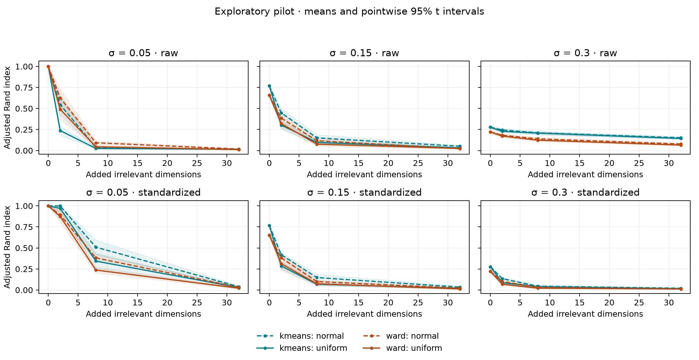

# Primeros hallazgos y decisión de investigación

Piloto exploratorio v1, 2026-09-21. [Informe completo](results/pilot-v1/REPORT.es.md).
No equivale a un estudio confirmatorio, una demostración de novedad ni un paper terminado.

## Qué se ha ejecutado y auditado

420 datasets, 6.720 ajustes y 2.520 decisiones de selección de k, en 20 familias
independientes. Cero ajustes fallidos, cero selecciones fallidas y cero avisos.
Una repetición con la misma configuración, realizada para corregir la portabilidad
de los archivos, produjo exactamente las mismas métricas y decisiones: solo
cambian los tiempos y los metadatos de instrumentación. Se regeneraron las 420
huellas de datos y todas coincidieron. No se combinaron las dos ejecuciones como
si fuesen 40 réplicas: la muestra experimental sigue siendo de 20 familias.

## 1. La forma del ruido puede importar incluso con varianza igualada

Condición: cuatro grupos, dos coordenadas de señal, 100 muestras por grupo,
σ=0.05; K-means con k=4 suministrado. Ambas distribuciones de ruido tienen media
0.5 y varianza poblacional 1/12.

| Dos variables irrelevantes | ARI medio, datos originales | ARI medio, estandarizados |
| --- | --- | --- |
| Ruido uniforme | 0.237 | 0.970 |
| Ruido normal | 0.545 | 0.999 |

Sin ruido añadido, el ARI fue 1 en las 20 familias. El contraste emparejado
normal-uniforme fue **0.308**, con intervalo t puntual del 95% **[0.181, 0.435]**,
en datos originales. Tras estandarizar fue **0.029**, con intervalo
**[-0.014, 0.071]**. Estos intervalos no están corregidos por comparaciones
múltiples y no constituyen una prueba confirmatoria.

Fuente: [distribution_contrasts.csv](results/pilot-v1/distribution_contrasts.csv)
y [oracle_summary.csv](results/pilot-v1/oracle_summary.csv). El resultado motiva
estudiar la interacción con el preprocesamiento; no demuestra que el ruido normal
sea universalmente menos perjudicial ni que esta observación sea nueva.

## 2. Recuperar etiquetas con k conocido y elegir k son problemas distintos

En esa misma condición, con datos estandarizados y dos variables irrelevantes:

| Criterio de selección entre k=2,...,8 | Veces que recupera k=4, ruido normal | Ruido uniforme |
| --- | --- | --- |
| Silhouette | 19/20 | 0/20 |
| Calinski–Harabasz | 2/20 | 1/20 |
| Davies–Bouldin | 0/20 | 0/20 |

Por tanto, un ARI elevado cuando proporcionamos k no implica que un procedimiento
sin etiquetas seleccione ese k. Para Silhouette, los intervalos Wilson son
[0.764, 0.991] y [0, 0.161], respectivamente. Los resultados son condicionales
al conjunto de candidatos: no equivalen a una comparación con búsqueda ilimitada.

Fuente: [k_recovery.csv](results/pilot-v1/k_recovery.csv). Esta es una pista útil
para formular un estudio ampliado, no una recomendación general contra un índice.

## 3. Una caída del índice no implica por sí sola un fallo de etiquetado

Silhouette también disminuye al añadir ruido cuando se mantienen las etiquetas
generadoras fijas. El fenómeno refleja cambios de geometría; debe separarse de
los cambios de partición. Además, con solapamiento, los componentes generadores
no tienen por qué coincidir con el objetivo geométrico de cada índice.

## Limitaciones que deben orientar la siguiente fase

- Una sola geometría cuadrada, dos dimensiones de señal y tamaños equilibrados.
- Solo K-means y Ward; Ward recibe k real. No representa todos los algoritmos.
- No hay comparación experimental con HAWKS u otros generadores.
- El ruido tiene varianza fija; al cambiar σ también cambia la varianza marginal
  de la señal en datos originales. No atribuir toda interacción únicamente a
  "solapamiento". La estandarización introduce otra geometría, no una corrección neutral.
- Veinte familias dan incertidumbre apreciable. Los intervalos t sin truncar pueden
  superar límites naturales de la métrica y degenerar en casos con todas las
  réplicas iguales; son aproximaciones exploratorias, no garantías.
- Algunos índices seleccionan extremos del rango de k: la sensibilidad al rango
  de búsqueda debe estudiarse con otro diseño.
- El antecedente de McCrory y Thomas (2024) cubre ruido, escalado y métricas.
  La diferenciación de nuestra contribución sigue pendiente de revisión más amplia.

## Decisión propuesta

Continuar con una segunda fase centrada en **selección de k bajo contaminación
dimensional**, manteniendo un diseño emparejado y comparando variancias de ruido
controladas. Antes de ejecutarla: completar antecedentes, ampliar el rango de k,
definir controles de amplitud y geometría, e introducir semillas independientes.
La precisión Monte Carlo deseada debe determinar cuántas familias necesitamos.

Preparar el manuscrito después de cerrar esa decisión científica. La candidatura
a una revista de software dependerá también de utilidad y reutilización externa.
