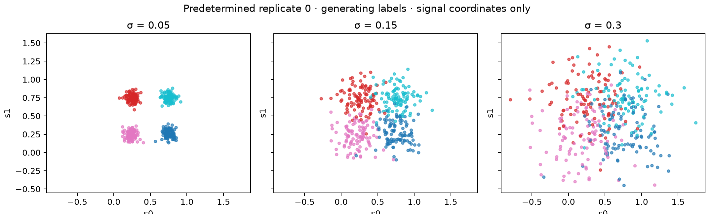
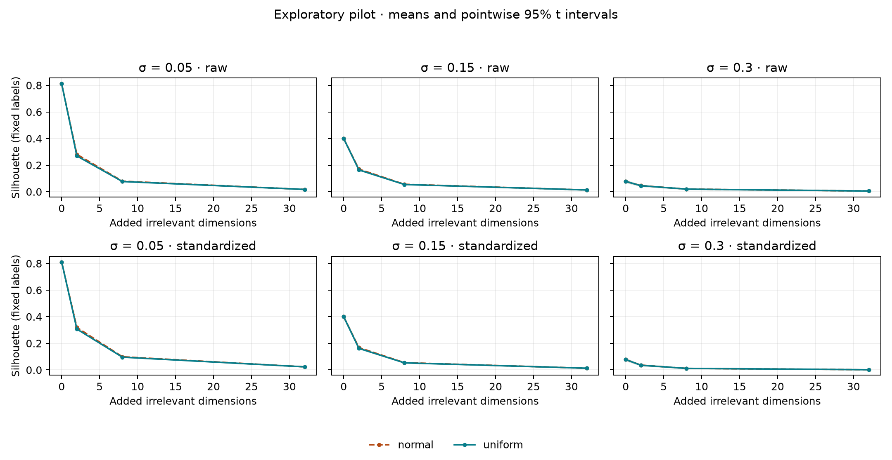

# Piloto exploratorio: resultados reproducibles

**No es un paper terminado ni una demostración de novedad.**
Protocolo: [protocol.md](protocol.md). Configuración: [config.json](config.json).
Diseño: `paired-noise-v1`. Código: `d809632ed713cf193d1ec8dc9178b9e5f0d093e3`;
árbol modificado al ejecutar: `False`.

## Ejecución y alcance

- 420 datasets; 6720 ajustes;
  2520 decisiones de selección de k.
- 20 familias independientes, emparejadas entre condiciones.
- 0 ajustes no válidos;
  0 selecciones no válidas;
  0 ajustes con avisos.
- Tiempo total de ejecución: 94.9 segundos, un hilo.
- 4 grupos gaussianos equilibrados, 2 coordenadas
  de señal y 100 observaciones por grupo. No generalizar a otras geometrías.

## Recuperación con el número real de grupos proporcionado

ARI=1 indica coincidencia perfecta con las etiquetas generadoras. Cada media
resume familias independientes; los intervalos t son puntuales y exploratorios.
`n` es el número de ajustes válidos, no el número de observaciones del dataset.

Sin ruido añadido:

| std | preprocessing | method | mean | ci_low | ci_high | n |
| --- | --- | --- | --- | --- | --- | --- |
| 0.050 | raw | kmeans | 1.000 | 1.000 | 1.000 | 20 |
| 0.050 | raw | ward | 1.000 | 1.000 | 1.000 | 20 |
| 0.050 | standardized | kmeans | 1.000 | 1.000 | 1.000 | 20 |
| 0.050 | standardized | ward | 1.000 | 1.000 | 1.000 | 20 |
| 0.150 | raw | kmeans | 0.768 | 0.758 | 0.779 | 20 |
| 0.150 | raw | ward | 0.657 | 0.630 | 0.683 | 20 |
| 0.150 | standardized | kmeans | 0.769 | 0.758 | 0.779 | 20 |
| 0.150 | standardized | ward | 0.654 | 0.629 | 0.678 | 20 |
| 0.300 | raw | kmeans | 0.277 | 0.260 | 0.294 | 20 |
| 0.300 | raw | ward | 0.221 | 0.205 | 0.237 | 20 |
| 0.300 | standardized | kmeans | 0.277 | 0.260 | 0.294 | 20 |
| 0.300 | standardized | ward | 0.221 | 0.203 | 0.239 | 20 |

Con 32 variables irrelevantes:

| std | distribution | preprocessing | method | mean | ci_low | ci_high | n |
| --- | --- | --- | --- | --- | --- | --- | --- |
| 0.050 | normal | raw | kmeans | 0.014 | 0.008 | 0.021 | 20 |
| 0.050 | normal | raw | ward | 0.018 | 0.012 | 0.024 | 20 |
| 0.050 | normal | standardized | kmeans | 0.040 | 0.029 | 0.050 | 20 |
| 0.050 | normal | standardized | ward | 0.032 | 0.022 | 0.042 | 20 |
| 0.050 | uniform | raw | kmeans | 0.016 | 0.011 | 0.020 | 20 |
| 0.050 | uniform | raw | ward | 0.012 | 0.007 | 0.016 | 20 |
| 0.050 | uniform | standardized | kmeans | 0.031 | 0.024 | 0.038 | 20 |
| 0.050 | uniform | standardized | ward | 0.021 | 0.012 | 0.030 | 20 |
| 0.150 | normal | raw | kmeans | 0.051 | 0.038 | 0.063 | 20 |
| 0.150 | normal | raw | ward | 0.022 | 0.017 | 0.027 | 20 |
| 0.150 | normal | standardized | kmeans | 0.034 | 0.023 | 0.045 | 20 |
| 0.150 | normal | standardized | ward | 0.022 | 0.014 | 0.031 | 20 |
| 0.150 | uniform | raw | kmeans | 0.032 | 0.021 | 0.043 | 20 |
| 0.150 | uniform | raw | ward | 0.025 | 0.017 | 0.033 | 20 |
| 0.150 | uniform | standardized | kmeans | 0.020 | 0.013 | 0.027 | 20 |
| 0.150 | uniform | standardized | ward | 0.012 | 0.007 | 0.018 | 20 |
| 0.300 | normal | raw | kmeans | 0.152 | 0.137 | 0.167 | 20 |
| 0.300 | normal | raw | ward | 0.078 | 0.065 | 0.090 | 20 |
| 0.300 | normal | standardized | kmeans | 0.021 | 0.014 | 0.028 | 20 |
| 0.300 | normal | standardized | ward | 0.012 | 0.008 | 0.016 | 20 |
| 0.300 | uniform | raw | kmeans | 0.143 | 0.133 | 0.154 | 20 |
| 0.300 | uniform | raw | ward | 0.065 | 0.056 | 0.074 | 20 |
| 0.300 | uniform | standardized | kmeans | 0.014 | 0.009 | 0.019 | 20 |
| 0.300 | uniform | standardized | ward | 0.012 | 0.008 | 0.017 | 20 |

Los efectos emparejados ARI(q)-ARI(0) están en [paired_summary.csv](paired_summary.csv).
El contraste normal-uniforme está en [distribution_contrasts.csv](distribution_contrasts.csv).
Los niveles comparten observaciones y no son réplicas independientes adicionales.

## Selección de k sin consultar las etiquetas

Proporción de selecciones que recuperan el k generador, con el máximo ruido:
intervalos Wilson sobre todos los intentos; un fallo de selección no cuenta como éxito.

| std | distribution | preprocessing | criterion | proportion | ci_low | ci_high | valid |
| --- | --- | --- | --- | --- | --- | --- | --- |
| 0.050 | normal | raw | calinski_harabasz | 0.000 | 0.000 | 0.161 | 20 |
| 0.050 | normal | raw | davies_bouldin | 0.000 | 0.000 | 0.161 | 20 |
| 0.050 | normal | raw | silhouette | 0.000 | 0.000 | 0.161 | 20 |
| 0.050 | normal | standardized | calinski_harabasz | 0.000 | 0.000 | 0.161 | 20 |
| 0.050 | normal | standardized | davies_bouldin | 0.000 | 0.000 | 0.161 | 20 |
| 0.050 | normal | standardized | silhouette | 0.050 | 0.009 | 0.236 | 20 |
| 0.050 | uniform | raw | calinski_harabasz | 0.000 | 0.000 | 0.161 | 20 |
| 0.050 | uniform | raw | davies_bouldin | 0.000 | 0.000 | 0.161 | 20 |
| 0.050 | uniform | raw | silhouette | 0.000 | 0.000 | 0.161 | 20 |
| 0.050 | uniform | standardized | calinski_harabasz | 0.000 | 0.000 | 0.161 | 20 |
| 0.050 | uniform | standardized | davies_bouldin | 0.000 | 0.000 | 0.161 | 20 |
| 0.050 | uniform | standardized | silhouette | 0.000 | 0.000 | 0.161 | 20 |
| 0.150 | normal | raw | calinski_harabasz | 0.000 | 0.000 | 0.161 | 20 |
| 0.150 | normal | raw | davies_bouldin | 0.000 | 0.000 | 0.161 | 20 |
| 0.150 | normal | raw | silhouette | 0.000 | 0.000 | 0.161 | 20 |
| 0.150 | normal | standardized | calinski_harabasz | 0.000 | 0.000 | 0.161 | 20 |
| 0.150 | normal | standardized | davies_bouldin | 0.000 | 0.000 | 0.161 | 20 |
| 0.150 | normal | standardized | silhouette | 0.000 | 0.000 | 0.161 | 20 |
| 0.150 | uniform | raw | calinski_harabasz | 0.000 | 0.000 | 0.161 | 20 |
| 0.150 | uniform | raw | davies_bouldin | 0.000 | 0.000 | 0.161 | 20 |
| 0.150 | uniform | raw | silhouette | 0.000 | 0.000 | 0.161 | 20 |
| 0.150 | uniform | standardized | calinski_harabasz | 0.000 | 0.000 | 0.161 | 20 |
| 0.150 | uniform | standardized | davies_bouldin | 0.000 | 0.000 | 0.161 | 20 |
| 0.150 | uniform | standardized | silhouette | 0.000 | 0.000 | 0.161 | 20 |
| 0.300 | normal | raw | calinski_harabasz | 0.000 | 0.000 | 0.161 | 20 |
| 0.300 | normal | raw | davies_bouldin | 0.000 | 0.000 | 0.161 | 20 |
| 0.300 | normal | raw | silhouette | 0.000 | 0.000 | 0.161 | 20 |
| 0.300 | normal | standardized | calinski_harabasz | 0.000 | 0.000 | 0.161 | 20 |
| 0.300 | normal | standardized | davies_bouldin | 0.000 | 0.000 | 0.161 | 20 |
| 0.300 | normal | standardized | silhouette | 0.000 | 0.000 | 0.161 | 20 |
| 0.300 | uniform | raw | calinski_harabasz | 0.000 | 0.000 | 0.161 | 20 |
| 0.300 | uniform | raw | davies_bouldin | 0.000 | 0.000 | 0.161 | 20 |
| 0.300 | uniform | raw | silhouette | 0.000 | 0.000 | 0.161 | 20 |
| 0.300 | uniform | standardized | calinski_harabasz | 0.000 | 0.000 | 0.161 | 20 |
| 0.300 | uniform | standardized | davies_bouldin | 0.000 | 0.000 | 0.161 | 20 |
| 0.300 | uniform | standardized | silhouette | 0.000 | 0.000 | 0.161 | 20 |

Resultados para todos los niveles: [k_recovery.csv](k_recovery.csv).
Pérdida de ARI respecto a la mejor partición candidata (referencia oráculo, no
procedimiento utilizable): [selection_summary.csv](selection_summary.csv).

## Diagnóstico: las etiquetas no cambian, la geometría sí

Esta figura calcula Silhouette con las etiquetas generadoras fijas. Una variación
no representa una reclasificación. Por sí sola tampoco demuestra que un índice
sea incorrecto: describe una geometría diferente al incluir dimensiones irrelevantes.
Con solapamiento, recuperar componentes generadores y encontrar una partición
geométricamente preferida son objetivos distintos.

## Interpretación y próximos pasos

Este piloto comprueba viabilidad y estima variabilidad. No compara la superioridad
del generador frente a otros, ni establece recomendaciones generales de algoritmos.
Hay un antecedente cercano sobre ruido y métricas (McCrory y Thomas, 2024);
la novedad de una eventual contribución permanece por demostrar.

Antes de ampliar: revisar fallos y emparejamiento, evaluar los tamaños de efecto
por condición, completar la revisión de literatura y congelar otro protocolo con
semillas independientes. Añadir dimensiones requiere controlar la separación.
Ampliar algoritmos, geometrías y tamaños muestrales será una fase posterior.

## Auditoría

Datos de ajustes: [fits.csv](fits.csv); selección: [selections.csv](selections.csv);
diagnósticos por dataset: [datasets.jsonl](datasets.jsonl); metadatos y hashes:
[manifest.json](manifest.json). La galería exporta la réplica 0 para todas las
dispersiones, sin ruido y con el máximo ruido; no se seleccionaron ejemplos por resultados.
PDF de las figuras disponible junto a cada PNG.
